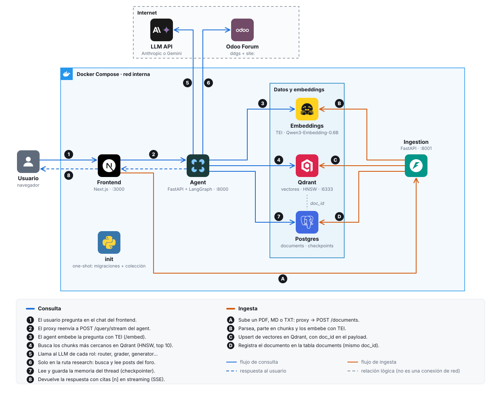

# Odoo RAG: asistente agéntico sobre la documentación de Odoo 19

Asistente técnico que responde en **español** preguntas de desarrollo sobre **Odoo 19**. Usa un grafo agéntico (LangGraph) con tres partes:

- un **supervisor** que decide la ruta;
- un **agente de documentación** (RAG sobre la sección Developer, con citas `[n]`);
- un **agente de investigación** que busca en el foro de Odoo cuando la documentación no alcanza.

Guarda memoria por conversación (`thread_id`) e incluye un modo lineal (`retrieve → generate`) como baseline de evaluación.

### Arquitectura

<picture>
  <source media="(prefers-color-scheme: dark)" srcset="docs/diagrams/architecture-dark.svg">
  
</picture>

Todo corre en Docker Compose, dentro de una red interna. Solo el LLM y el foro de Odoo son externos. TEI, Qdrant y Postgres no se conectan entre sí: el agent y la ingesta orquestan cada paso, y el `doc_id` une los puntos de Qdrant con la fila de `documents` en Postgres.

### Grafo agéntico

<picture>
  <source media="(prefers-color-scheme: dark)" srcset="docs/diagrams/agent-graph-dark.svg">
  
</picture>

Cada camino termina en un nodo que produce la respuesta (marcado `→ respuesta`):

- **direct:** saludos o preguntas fuera de alcance, sin recuperación.
- **docs:** RAG con citas `[n]`. Si el grader no encuentra chunks relevantes, el rewriter reformula la pregunta (y la traduce al inglés) hasta `MAX_REWRITES` veces. Después, el subgrafo **delega** al agente de investigación.
- **research:** búsqueda en el foro de Odoo, con hasta `RESEARCH_MAX_ITERATIONS` vueltas por el bucle de tools.

### Stack y decisiones

Resumen de las decisiones D-01 a D-14. El contexto, las alternativas y la evidencia completa están en [`backlog.md`](backlog.md) (sección *Decisiones*).

| Área | Elección | Por qué (y qué se descartó) |
|---|---|---|
| Orquestación (D-02) | **LangGraph**: supervisor, `docs_agent` como subgrafo y bucle de tools escrito a mano. Estado `TypedDict` con reducers; Pydantic para las salidas del LLM | Trae checkpointer, `interrupt`, `astream` y `draw_mermaid()` nativos. Se descartaron LlamaIndex Workflows y PydanticAI Graph (HITL, persistencia y streaming menos maduros) |
| LLM (D-03) | **Un modelo por rol, con proveedor configurable** (`LLM_PROVIDER`): Claude Haiku / Sonnet o Gemini Flash-Lite / Flash. El juez del eval es un modelo distinto del generador | Modelo barato para tareas cortas (router, grader, rewriter) y fuerte para síntesis y tools. Juez distinto para evitar la autoevaluación. Se descartaron Ollama (pesado, tool calling débil) y Groq |
| Embeddings (D-04) | **`Qwen/Qwen3-Embedding-0.6B` servido con TEI** | Ver [abajo](#por-qué-qwen3-embedding-06b) |
| Vectores (D-05) | **Qdrant**: vector denso de 1024 dims (coseno, HNSW) y vector `sparse` BM25 reservado para búsqueda híbrida | Filtros, búsqueda híbrida y RRF nativos en un servicio liviano. Se descartaron pgvector (híbrida y fusión manuales), Chroma, Milvus, Weaviate y Pinecone |
| Chunking (D-06) | **Jerárquico**: corte por encabezados H1–H3 y luego recursivo a ~512 tokens, con 64 de overlap, contados con el tokenizer de Qwen3. El código nunca se corta y la ruta de sección se antepone al texto que se embebe | La documentación ya está estructurada; `section` da citas precisas sin costo extra. Se descartaron el corte de tamaño fijo (corta código) y el semántico (caro y no determinista) |
| Búsqueda externa (D-07) | **Tools propias**: `search_odoo_forum` (`ddgs` con `site:` y allowlist de dominios) y `read_forum_post`, con timeout, reintentos, caché y estados explícitos | No necesita key. El `robots.txt` de odoo.com prohíbe usar su buscador, así que se busca por fuera y se leen los posts. Plan B: SearXNG con la misma interfaz |
| Memoria y registro (D-08) | **Postgres**: `AsyncPostgresSaver` (memoria por `thread_id`) y tabla `documents`. `contextualize` reescribe los seguimientos antes del router | Concurrencia real, persistencia para HITL y registro relacional para listar y borrar documentos. Se descartaron SQLite, InMemory y Redis |
| Frontend (D-09) | **Next.js** como cliente delgado: tipos generados desde OpenAPI, SSE y `/analytics` | Control visual y dashboard de evaluación propio. Se descartaron Chainlit, Streamlit y Gradio |
| Servicios (D-10) | `agent` (lectura), `ingestion` (escritura), `embeddings` (TEI), Qdrant, Postgres, `frontend` e `init` (one-shot), todos en Docker Compose; `eval` corre como caja negra contra la API | El modelo de embeddings se carga una sola vez; `agent` e `ingestion` no instalan torch. Se descartaron el monolito y los embeddings embebidos en cada servicio |
| Corpus (D-11) | **~60 páginas curadas de Odoo 19 Developer** (HTML renderizado convertido a Markdown) y 1 PDF | El HTML incluye el contenido generado con autodoc y da URLs citables. Se descartaron el RST fuente (incompleto) y la sección completa (ruido) |
| Evaluación (D-12) | **Métricas propias** más un juez LLM con prompts versionados y salida estructurada | Transparente y defendible; maneja respuesta en español con contexto en inglés. Se descartaron Ragas (API inestable) y DeepEval (pesado, atado a una plataforma) |
| Extensibilidad (D-13) | Interfaces `Embedder`, `Retriever`, `Reranker` y `SearchProvider`, eventos tipados y feature flags (`HITL_ENABLED`, `RETRIEVER`, `RERANKER`, `SEARCH_PROVIDER`) | Los retos opcionales se agregan sin refactorizar ni cambiar los esquemas |
| Calidad (D-14) | uv workspace, Python 3.12, Ruff, mypy, pytest (con LLM falso, sin red), gitleaks y pre-commit | Builds reproducibles y reglas verificables, incluida la de no subir secretos |
| Alcance (D-01) | Retos por costo y beneficio: C (streaming) ✅, D (HITL) con backend listo; E, F y A en el plan; B (híbrida con rerank) como stretch | Se priorizó lo que alimenta la evaluación y la demo, en lugar de prometer los 6 retos |

#### Por qué Qwen3-Embedding-0.6B

El embedding decide la calidad de la recuperación y fija la dimensión de la colección, así que fue la decisión más estudiada.

- **Código y multilingüe a la vez.** Era el único candidato con score de código publicado (MTEB-Code 75,41), y además tiene buen desempeño multilingüe (MMTEB 64,33, más de 100 idiomas). La documentación mezcla prosa en inglés con bloques de Python, XML y JavaScript.
- **Búsqueda cross-lingual medida, no supuesta.** Las preguntas llegan en español y el corpus está en inglés. En la evaluación (E-09), recall@10 es igual con la pregunta en español o traducida al inglés: 0,64 en ambos casos, con MRR de 0,82 en español y 0,86 en inglés. No hace falta traducir para recuperar.
- **Instruction-aware.** La instrucción de tarea (`Instruct: …\nQuery: …`) se agrega solo a las consultas, nunca a los documentos. Aplicarla mal degrada la recuperación entre 1 % y 5 %.
- **Tamaño justo.** 0,6B parámetros y 1024 dimensiones (con MRL, ajustable de 32 a 1024). Corre en CPU con unos 4 GB de RAM, o en GPU con `make up-gpu`. Admite 32K tokens de contexto, pero los chunks son de ~512: los chunks grandes diluyen el vector.
- **Abierto y local.** Licencia Apache 2.0, sin API key ni costo por token. Lo sirve [TEI](https://github.com/huggingface/text-embeddings-inference) en un solo contenedor con batching dinámico.
- **Familia coherente.** Qwen3-Reranker sirve para el reto B y ya está previsto en el flag `RERANKER=qwen3`. El tokenizer de Qwen3 también cuenta los tokens del chunking, así que los tamaños coinciden con lo que ve el modelo.
- **Índice.** HNSW (`m=16`, `ef_construct=200`) recupera lo mismo que la búsqueda exacta desde `hnsw_ef=32` (recall@10 de 0,997 con `ef=16`), con ~1,2 ms por consulta.
- **Descartados:** APIs de Voyage, OpenAI y Cohere (key extra y costo), fastembed (catálogo limitado y desactualizado), `bge-m3` (más antiguo y con menor score), jina v3/v4 (licencia CC-BY-NC) y Harrier-0.6B (sin scores de código publicados).

### Evaluación: ¿por qué agéntico?

**Cómo se midió.** Las 31 preguntas del golden set ([`eval/golden/golden_set.yaml`](eval/golden/golden_set.yaml)) se distribuyen así:

| Categoría | Preguntas |
|---|---|
| Cubiertas por la documentación | 17 |
| No cubiertas | 6 |
| Fuera de alcance | 4 |
| Seguimientos (2 hilos de 2 turnos) | 4 |

Cada pregunta pasó por la misma API en dos modos:

- **`agentic`:** el grafo completo.
- **`linear`:** `retrieve → generate` con top 10, sin router, grader ni memoria.

Los dos modos usan el mismo retriever y el mismo generator; solo cambia la orquestación. Modelos de la corrida: Gemini 3.5 Flash-Lite para las tareas cortas y 3.8 Flash para el generator y research. El juez fue Gemini 3.6 Flash, distinto del generator para evitar la autoevaluación. Corrida del 2026-11-03 sobre el commit `a4f12e0`, que se reproduce con `make eval`. El detalle por pregunta está en `/analytics` y en [`eval/README.md`](eval/README.md).

| Métrica | Agéntico | Lineal | |
|---|---|---|---|
| Agente final correcto (supervisor) | **31/31** | — | el router acierta el 94 % al primer intento; el resto se corrige delegando |
| Comportamiento en fuera de alcance | **4/4** | 2/4 | |
| Comportamiento en no cubiertas | **5/6** | 3/6 | |
| Context precision (chunks útiles / chunks enviados) | **0,90** | 0,68 | |
| Corrección de citas | **0,81** | 0,73 | |
| Tokens de entrada del generator | **1.390** | 3.965 | 2,8 chunks contra 10 |
| Faithfulness | 0,98 | **1,00** | |
| Answer correctness (F1) | 0,72 | **0,76** | gana en 5 preguntas y pierde en 11 de 21 |
| Context recall (secciones esperadas) | 0,52 | **0,61** | |
| Latencia p50 / p95 | 13,1 / 35,6 s | **9,5 / 13,4 s** | el bucle del foro pesa en el p95 |
| Costo por pregunta | 0,0069 USD | **0,0062 USD** | con precios del tier pagado; en el tier gratis cuesta 0 |

**La lectura honesta.** Cuando la documentación cubre la pregunta, el RAG lineal ya trae lo necesario en el top 10, y el agente **no redacta mejor**: su F1 es algo menor, porque el grader descarta contexto útil (falla 1, más abajo). El agente gana en lo que el pipeline lineal no puede hacer:

1. **Decidir qué tipo de pregunta es.** Ante "Hola, ¿qué puedes hacer?", el lineal recupera chunks y enumera temas con citas en lugar de presentarse. Ante "¿cómo invierto una cadena en Python?", contesta que la documentación no lo trae, sin reconocer que está fuera de alcance. El supervisor manda las dos a `direct_answer` sin recuperar nada.
2. **Saber cuándo la documentación no alcanza y buscar en otro lado.** En q22 (conciliación bancaria, que no está en el corpus), el rewriter reformuló la pregunta dos veces en inglés. Como el grader siguió sin encontrar chunks relevantes, el subgrafo delegó al foro y la respuesta salió con fuentes externas marcadas. El lineal dice "no está en la documentación" y ahí se queda.
3. **Enviar menos contexto, y más limpio.** Precisión de 0,90 contra 0,68, con un 65 % menos de tokens en el generator y citas más correctas.

Un hallazgo adicional: el filtro del grader **depende del modelo**. En la corrida anterior con Claude Haiku como grader, el agente enviaba 4,0 chunks y ganaba en F1 (0,65 contra 0,62). Con Flash-Lite envía 2,8 y pierde (0,72 contra 0,76). Esas dos corridas usan jueces distintos, así que la comparación es indicativa.

#### Casos de falla

**Falla 1: el grader descarta contexto necesario (q08).**

> *"En una nueva versión de mi módulo renombré un campo. ¿Cómo escribo el script de migración para que no se pierdan los datos ni se rompan filtros o acciones que lo usan?"*

- **Qué pasó:** de los 10 chunks recuperados, el grader conservó 2. Descartó los que explican la **estructura** del script: la función `migrate(cr, version)`, la carpeta `migrations/<versión>/` y los prefijos `pre-`, `post-` y `end-`. La respuesta explica `rename_field` pero no cómo armar ni ubicar el script.
- **Evidencia:**

  | | Agéntico | Lineal |
  |---|---|---|
  | Context recall | 0,17 | 0,67 |
  | Correctness (F1) | 0,42 | 0,63 |

- **Causa raíz:** el grader juzga cada chunk contra la pregunta literal ("renombrar un campo"). Una pregunta compuesta necesita también los chunks que responden la otra mitad ("cómo escribo el script").
- **Mejora propuesta:** cambiar el veredicto del grader por chunk a uno de **suficiencia** del conjunto ("¿alcanza este contexto para responder todo?"), o exigir un mínimo de k chunks por subpregunta.

**Falla 2: el contextualizador resuelve mal una referencia (q31, seguimiento).**

> Turno 1: *"Desde un componente OWL del cliente web, ¿cómo llamo a un método de un modelo Python?"* (respuesta: con el **servicio** `orm`).
> Turno 2: *"¿Y si quiero crear uno de esos pero propio, cómo lo defino y lo registro para que el cliente web lo arranque?"*

- **Qué pasó:** `contextualize` interpretó "uno de esos" como un *componente OWL* y reescribió la pregunta así: "¿Cómo defino y registro un componente OWL propio…?". El usuario se refería a un **servicio** (`start(env, deps)` y `registry.category("services").add(...)`). El agente recuperó chunks sobre client actions y respondió con seguridad, bien redactado y con citas, pero **a otra pregunta**.
- **Evidencia:** 0 chunks relevantes y F1 = 0. El lineal también falla, por otra razón: no tiene memoria.
- **Causa raíz:** el contextualizador sí recibe el turno anterior completo (pregunta y respuesta, recortadas a 800 caracteres), y la respuesta empieza diciendo "se debe utilizar el **servicio** `orm`". Aun así, el modelo de esa tarea (Flash-Lite, el más pequeño) resolvió la referencia ambigua con el sustantivo de la pregunta del usuario. Es un error de resolución de correferencia, no de falta de información. En la corrida anterior, con Claude Haiku en ese rol, la misma pregunta se reescribió bien («un servicio propio… como `orm`»).
- **Mejora propuesta:** indicar en el prompt de `contextualize` que resuelva las referencias ("uno de esos", "eso") hacia la entidad que **explicó la respuesta anterior**, y probar un modelo más capaz solo para ese rol, que es barato porque procesa pocos tokens. Si hay dos candidatos, que pida una aclaración en lugar de adivinar.

Detalle técnico y decisiones de diseño: [`docs/ARCHITECTURE.md`](docs/ARCHITECTURE.md). Evaluación: [`eval/README.md`](eval/README.md).

---

## 1. Requisitos

- **Docker** con **Docker Compose ≥ 2.17** (se usa `additional_contexts`). Comprueba la versión con `docker compose version`.
- **8 GB de RAM libres** como mínimo: TEI en CPU usa unos 4 GB.
- **Internet** en el primer arranque, para construir las imágenes y descargar el modelo de embeddings.
- **Puertos libres** en `127.0.0.1`: 3000 (frontend), 8000 (agente), 8001 (ingesta) y 6333 (Qdrant).
- **Una API key de LLM:** de [Google AI Studio](https://aistudio.google.com/apikey), que tiene tier gratis, o de [Anthropic](https://console.anthropic.com/).
- **Opcional:** `make`, [`uv`](https://docs.astral.sh/uv/) (para tests y lint fuera de Docker) y una GPU NVIDIA con NVIDIA Container Toolkit.

## 2. Levantar el sistema paso a paso

### Paso 1. Clonar el repositorio

```bash
git clone <url-del-repo> finanzauto
cd finanzauto
```

### Paso 2. Crear el `.env`

```bash
make env          # copia .env.example a .env si no existe
```

Abre `.env` y configura **solo el proveedor de LLM**. El resto de valores ya tiene defaults que funcionan.

**Opción A: Gemini (tier gratis)**

```dotenv
LLM_PROVIDER=google
GOOGLE_API_KEY=<tu key de AI Studio>
LLM_MODEL_CONTEXTUALIZER=gemini-3.5-flash-lite
LLM_MODEL_ROUTER=gemini-3.5-flash-lite
LLM_MODEL_GRADER=gemini-3.5-flash-lite
LLM_MODEL_REWRITER=gemini-3.5-flash-lite
LLM_MODEL_DIRECT=gemini-3.5-flash-lite
LLM_MODEL_GENERATOR=gemini-3.8-flash
LLM_MODEL_RESEARCH=gemini-3.8-flash
LLM_MODEL_JUDGE=gemini-3.6-flash
```

**Opción B: Anthropic (default)**

```dotenv
LLM_PROVIDER=anthropic
ANTHROPIC_API_KEY=<tu key>
# Solo si la key es de organización y no está asociada a un workspace:
# ANTHROPIC_WORKSPACE_ID=wrkspc_...
```

Con Anthropic no hace falta tocar los `LLM_MODEL_*`: los defaults ya son modelos Claude.

> `.env` está en `.gitignore`. No subas tus keys al repositorio.

### Paso 3. Construir y arrancar

```bash
make up           # CPU
# make up-gpu     # alternativa con GPU NVIDIA para TEI
```

`make up` construye las imágenes, ejecuta `init` (migraciones de Postgres y creación de la colección de Qdrant) y espera a que los servicios estén sanos. La primera vez tarda varios minutos, porque construye las imágenes y TEI descarga el modelo. Las siguientes, con la caché de build, tarda unos 3 minutos o menos.

### Paso 4. Verificar el estado

```bash
make ps                          # postgres, qdrant, embeddings, ingestion, agent y frontend en healthy
curl -s localhost:8000/health    # {"status":"ok","deps":{"qdrant":true,"postgres":true,"embeddings":true}}
curl -s localhost:8001/health
```

### Paso 5. Indexar el corpus

```bash
make seed         # FORCE=1 make seed reindexa aunque el contenido no haya cambiado
```

Ingiere `data/corpus/odoo19-dev/` (58 páginas de la documentación Developer de Odoo 19 y un PDF) a través de `POST /documents`. El resultado esperado son 59 documentos y 832 chunks. Si se repite, los documentos que no cambiaron se omiten. Licencia y procedencia del corpus: [`data/corpus/README.md`](data/corpus/README.md).

Para confirmar los datos:

```bash
docker compose exec postgres psql -U odoo_rag -d odoo_rag -c \
  "SELECT status, count(*), sum(n_chunks) FROM documents GROUP BY status;"
```

En la interfaz visual de Qdrant (http://localhost:6333/dashboard), la colección `odoo19_dev` debe tener 832 puntos.

### Paso 6. Usar el asistente

| Qué | URL |
|---|---|
| Chat (modo agéntico o lineal, fuentes y pasos de cada respuesta) | http://localhost:3000 |
| Dashboard de evaluación | http://localhost:3000/analytics |
| Swagger del agente | http://localhost:8000/docs |
| Swagger de la ingesta | http://localhost:8001/docs |
| Interfaz de Qdrant | http://localhost:6333/dashboard |

Preguntas para probar las rutas del grafo:

| Pregunta | Ruta esperada |
|---|---|
| ¿Cómo defino un campo computed almacenado en Odoo 19? | `docs`, con citas a la documentación |
| ¿Y cómo hago que se pueda buscar? (en la misma conversación) | `docs`, con la pregunta reescrita usando el historial |
| En el foro de Odoo, ¿cómo se soluciona `ValueError: Expected singleton`? | `research`, con posts del foro |
| Hola, ¿me recomiendas una receta de pasta? | `direct`, fuera de alcance y sin recuperación |

### Paso 7. Apagar

```bash
make down
```

> **No uses `docker compose down -v`.** Borra los volúmenes, es decir, el índice de Qdrant, el registro de documentos y las conversaciones, y obliga a repetir el `make seed`.

---

## 3. Documentación de la API

Hay dos servicios. Los puertos 8000, 8001 y 6333 solo se publican en `127.0.0.1`, mediante `compose.override.yaml`, que Docker Compose carga automáticamente. El frontend llega a ambos a través de su proxy: `/api/agent/...` y `/api/ingestion/...`.

- **Swagger interactivo:** http://localhost:8000/docs y http://localhost:8001/docs.
- **Specs OpenAPI:** [`frontend/openapi/agent.json`](frontend/openapi/agent.json) y [`frontend/openapi/ingestion.json`](frontend/openapi/ingestion.json). Se regeneran con `make openapi`.
- **Colección de Postman:** [`docs/api/odoo-rag.postman_collection.json`](docs/api/odoo-rag.postman_collection.json) (ver §3.3).

### 3.1 Ingesta (`localhost:8001`)

| Método | Ruta | Descripción |
|---|---|---|
| `GET` | `/health` | Estado de Qdrant, Postgres y embeddings |
| `POST` | `/documents` | Sube un `.pdf`, `.md` o `.txt` (multipart; máximo `MAX_UPLOAD_MB`, 20 MB por defecto) |
| `GET` | `/documents?limit=&offset=&status=` | Lista los documentos (`{items, total}`) |
| `GET` | `/documents/{doc_id}` | Detalle de un documento |
| `DELETE` | `/documents/{doc_id}` | Borra el documento: sus puntos en Qdrant y su fila en el registro (`204`) |

```bash
# Subir un documento. Campos opcionales: source_url (URL canónica) y force=true (reindexar)
curl -s -X POST localhost:8001/documents -F "file=@mi_doc.md"
# {"doc_id":"b279…","name":"mi_doc.md","source":"mi_doc.md","status":"indexed",
#  "n_chunks":1,"content_hash":"…","action":"created","took_ms":183}

curl -s "localhost:8001/documents?limit=5"
curl -s localhost:8001/documents/<doc_id>
curl -s -X DELETE localhost:8001/documents/<doc_id>
```

`action` vale `created`, `updated` o `unchanged`. Si el hash del contenido no cambió, el documento no se reindexa, salvo que envíes `force=true`.

### 3.2 Agente (`localhost:8000`)

| Método | Ruta | Descripción |
|---|---|---|
| `GET` | `/health` | Estado de las dependencias |
| `POST` | `/query` | Pregunta. Devuelve la respuesta completa |
| `POST` | `/query/stream` | Lo mismo, con Server-Sent Events |
| `POST` | `/query/resume` | Aprueba o rechaza una búsqueda externa pendiente (HITL) |
| `POST` | `/search` | Solo recuperación de chunks, sin LLM |

**`POST /query`**

```json
{
  "question": "¿Cómo defino un campo computed almacenado en Odoo 19?",
  "thread_id": null,
  "mode": "agentic",
  "filters": {"doc_ids": ["<uuid>"], "sources": ["<source>"]}
}
```

- **`question`:** el único campo obligatorio (máximo 4000 caracteres).
- **`thread_id`:** identifica la conversación (memoria). Si es `null`, el servidor genera uno y lo devuelve. Reenvíalo para hacer preguntas de seguimiento.
- **`mode`:** `agentic` (default) o `linear` (baseline sin router, grader ni memoria).
- **`filters`:** opcional. Restringe la recuperación a ciertos documentos.

```bash
curl -s -X POST localhost:8000/query -H 'content-type: application/json' \
  -d '{"question":"¿Cómo defino un campo computed almacenado en Odoo 19?"}'
```

Campos principales de la respuesta:

| Campo | Contenido |
|---|---|
| `answer` | Respuesta en español con marcadores `[n]` |
| `sources[]` | Fuentes citadas (`kind`: documentación o foro) |
| `route` / `answered_by` | Ruta del supervisor y agente que respondió (`docs`, `research`, `direct`) |
| `delegated`, `external`, `no_context` | Si se delegó a investigación, si hay fuentes externas, si no hubo contexto |
| `standalone_question` | La pregunta reescrita con el historial |
| `steps[]` | Por nodo: modelo, tokens, `cost_usd`, `duration_ms` y `detail` |
| `usage` | Totales de tokens y costo en USD |
| `latency_ms` | Latencia total |
| `thread_id`, `run_id` | Identificadores de la conversación y de la ejecución |
| `interrupt` | Presente si el turno quedó pausado esperando `/query/resume` |

**Seguimiento en la misma conversación**

```bash
curl -s -X POST localhost:8000/query -H 'content-type: application/json' \
  -d '{"question":"¿Y cómo hago que se pueda buscar?","thread_id":"<thread_id de la respuesta anterior>"}'
```

**`POST /query/stream` (SSE)**

Acepta el mismo cuerpo que `/query`. Emite eventos `event: <tipo>` + `data: <json>`:

- `node_started` y `node_finished`: inicio y fin de cada nodo del grafo.
- `token`: texto parcial de la respuesta.
- `sources`: fuentes recuperadas.
- `interrupt`: el turno quedó pausado (HITL).
- `final`: la misma respuesta que devuelve `/query`.
- `error`: el turno falló.

```bash
curl -N -X POST localhost:8000/query/stream -H 'content-type: application/json' \
  -d '{"question":"¿Qué hace el decorador @api.depends?"}'
```

**`POST /query/resume` (HITL)**

Solo aplica con `HITL_ENABLED=true` en el `.env`. Antes de buscar en el foro, el grafo se pausa y la respuesta trae `interrupt`. Para continuar:

```bash
curl -s -X POST localhost:8000/query/resume -H 'content-type: application/json' \
  -d '{"thread_id":"<thread_id>","approved":true}'
```

**`POST /search`**

```bash
curl -s -X POST localhost:8000/search -H 'content-type: application/json' \
  -d '{"query":"computed field store","top_k":5}'
# {"results":[{"chunk_id":"…","doc_id":"…","score":0.82,"text":"…", …}],"took_ms":…}
```

Campos opcionales: `filters`, `exact` (búsqueda exacta, para comparar con HNSW), `hnsw_ef` y `with_instruction`.

**Errores**

Ambos servicios responden los 4xx y 5xx con el formato `{"detail":{"error":{"code":"…","message":"…"}}}`. Ejemplo:

```json
{"detail":{"error":{"code":"unsupported_type","message":"unsupported file type .exe; use .pdf, .md, .txt"}}}
```

Si el LLM falla durante el grafo, el stream emite un evento `error` con `code` igual a `llm_unavailable` o `upstream_timeout`.

### 3.3 Colección de Postman

1. En Postman, **Import** → [`docs/api/odoo-rag.postman_collection.json`](docs/api/odoo-rag.postman_collection.json).
2. Las variables de la colección traen valores listos: `agent_url` (`http://localhost:8000`) e `ingestion_url` (`http://localhost:8001`).
3. Ejecuta **Ingestion › Upload document**: en el campo `file`, selecciona un `.md`, `.txt` o `.pdf`. La petición guarda el `doc_id` en una variable, y lo usan *Get document*, *Delete document* y *Query - filtered by document*.
4. Ejecuta **Agent › Query - docs (agentic)**: guarda el `thread_id`, de modo que *Query - follow-up (memory)* continúa la misma conversación.

| Carpeta | Peticiones |
|---|---|
| Ingestion | Health, Upload, List, Get, Delete |
| Agent | Health, Query (docs, follow-up, forum research, out of scope, linear, filtered), Stream (SSE), Resume (HITL), Search |

Cada petición tiene descripción y tests básicos (status y campos clave). Desde la terminal también se puede correr con newman:

```bash
npx newman run docs/api/odoo-rag.postman_collection.json --folder "Agent (:8000)"
```

En newman, *Upload document* necesita la ruta del archivo en el campo `file`. Por eso, sin archivo, conviene correr solo la carpeta del agente.

---

## 4. Configuración

Todas las variables están en [`.env.example`](.env.example), comentadas, y la tabla completa está en [`docs/ARCHITECTURE.md` §9](docs/ARCHITECTURE.md). Las más útiles:

| Variable | Default | Uso |
|---|---|---|
| `LLM_PROVIDER` | `anthropic` | `anthropic` o `google` |
| `LLM_MODEL_<ROL>` | modelos Claude | Modelo de cada rol: contextualizer, router, grader, rewriter, direct, generator, research, judge |
| `LLM_EFFORT_ROUTER`, `LLM_EFFORT_GRADER` | `low` | Esfuerzo de razonamiento del router y el grader |
| `HITL_ENABLED` | `false` | Pide aprobación antes de buscar en el foro |
| `RETRIEVER_TOP_K` | `10` | Chunks recuperados por consulta |
| `MAX_REWRITES` | `2` | Reformulaciones máximas antes de delegar a investigación |
| `FRONTEND_PORT` | `3000` | Puerto del frontend en el host |

Los costos por modelo que se muestran en la API y en `/analytics` salen de [`packages/common/src/common/pricing.py`](packages/common/src/common/pricing.py).

## 5. Comandos de `make`

| Comando | Qué hace |
|---|---|
| `make up` / `make up-gpu` | Construye y arranca el stack (TEI en CPU o GPU) |
| `make seed` | Indexa el corpus (`FORCE=1` reindexa todo) |
| `make eval` | Corre la evaluación (`ARGS="--only q01,q28 --concurrency 1"`) y copia el resumen al dashboard |
| `make ps` / `make logs` | Estado de los servicios y logs en vivo |
| `make watch` | Modo desarrollo: reconstruye agent, ingestion y frontend al cambiar el código |
| `make test` / `make lint` | Tests (pytest) y lint (ruff y mypy), con `uv` en el host |
| `make openapi` | Regenera las specs OpenAPI y los tipos TS del frontend |
| `make graph` | Exporta el grafo a Mermaid (`docs/graph.mmd`) |
| `make down` | Detiene el stack sin borrar volúmenes |

Después de `make eval`, reconstruye el frontend para ver los resultados nuevos en `/analytics`: `docker compose up -d --build frontend`. El contenedor sirve el reporte que quedó dentro de la imagen al construirla.

## 6. Problemas frecuentes

| Síntoma | Causa y solución |
|---|---|
| `embeddings` se reinicia en bucle | Falta RAM: TEI necesita unos 4 GB. Libera memoria o usa `make up-gpu` |
| `/query` devuelve el evento `error` con `llm_unavailable` | Key inválida, sin saldo, o modelo que no corresponde a `LLM_PROVIDER`. Revisa `docker compose logs agent` |
| 429 en los logs | Límite de peticiones del tier gratis. Baja la concurrencia (`make eval ARGS="--concurrency 1"`) |
| `/analytics` no muestra la última evaluación | Reconstruye el frontend: `docker compose up -d --build frontend` |
| Puerto ocupado | Cambia `FRONTEND_PORT` en `.env`. Los puertos 8000, 8001 y 6333 están en `compose.override.yaml` |
| La búsqueda en el foro no devuelve resultados | `ddgs` puede quedar limitado temporalmente por el buscador. Reintenta en unos minutos |

## 7. Estructura del repositorio

```
services/agent       grafo LangGraph, API de consulta (/query, /search)
services/ingestion   parsing, chunking, embeddings, API de documentos
packages/common      settings, esquemas, LLM por rol, Qdrant, precios
infra/init           migraciones y creación de la colección (one-shot)
frontend             Next.js: chat, documentos y /analytics
eval                 golden set, métricas, jueces LLM y runners
data/corpus          snapshot de la documentación de Odoo 19 (CC BY-SA 4.0)
docs                 ARCHITECTURE.md, grafo Mermaid y colección de Postman
```
