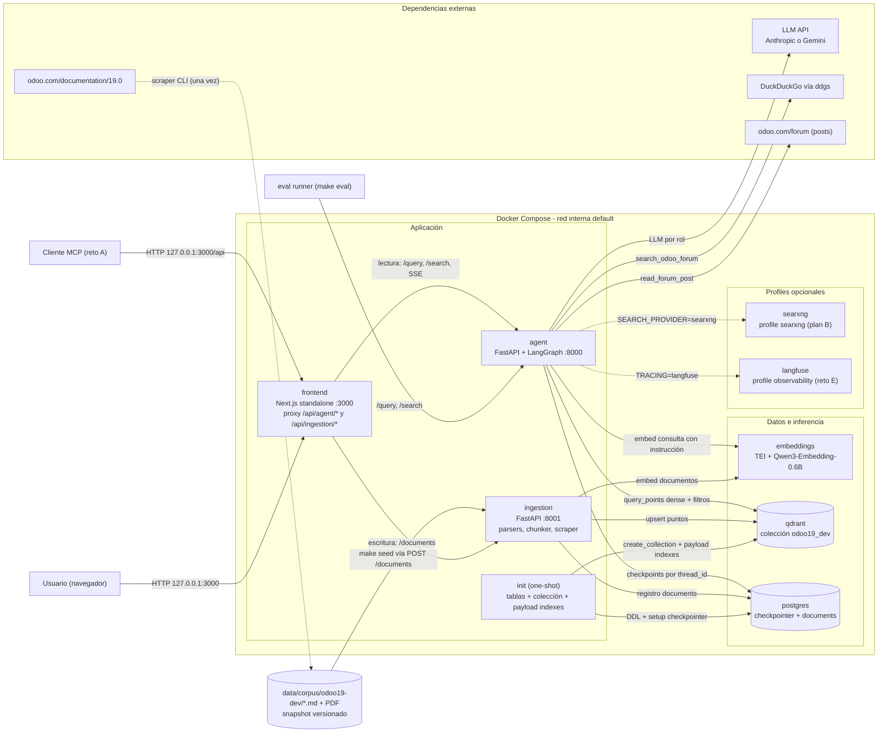
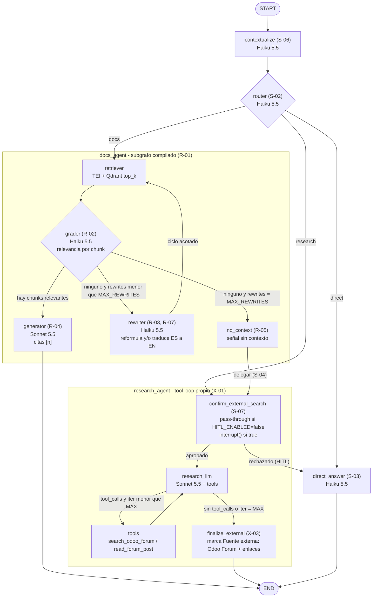
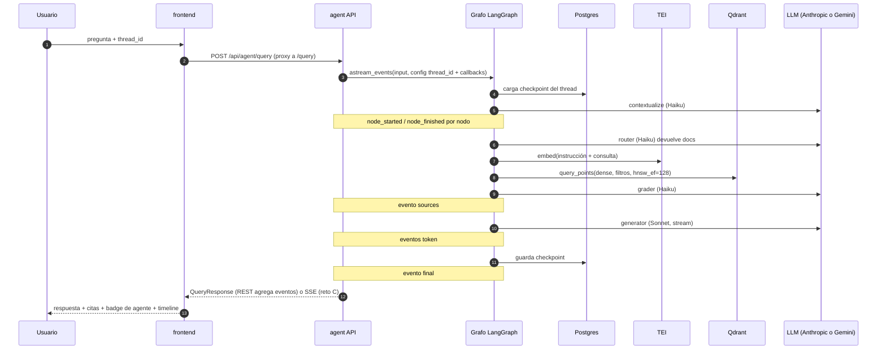
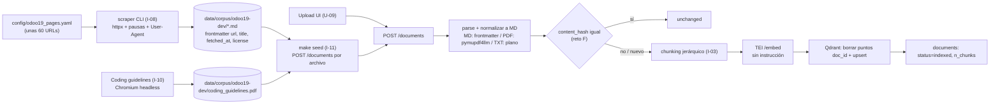

# Arquitectura y diseño — Asistente agéntico Odoo 19

> Documento de diseño consolidado a partir de `backlog.md` (decisiones D-01…D-14, ya con sus actualizaciones aplicadas). Las justificaciones viven en los ADR: aquí solo se citan `(D-xx)` y las tareas `(X-nn)`.
> Lo que no definió el backlog va marcado como **[Aprobado 2026-11-02]** y se repite al final, en «Decisiones propuestas por revisar».

---

## 1. Resumen

| Aspecto | Definición |
|---|---|
| Sistema | Asistente de conocimiento para desarrolladores: un RAG orquestado como grafo de agentes en LangGraph, con un supervisor, un subagente de documentación y un subagente de investigación (D-02). |
| Caso de uso | Documentación **Odoo 19 Developer** (en inglés, unas 60 páginas y 1 PDF, CC BY-SA 4.0) (D-11). Las consultas llegan en **español** y la respuesta final sale siempre en español (R-07). |
| Fuera de la documentación | Se busca solo en **Odoo Forum** (`odoo.com/forum`), usando `ddgs` con `site:` y leyendo posts individuales (D-07). |
| LLM | Proveedor configurable con `LLM_PROVIDER` (D-03). Por defecto Anthropic: `claude-haiku-5-5` (tareas cortas), `claude-sonnet-5-5` (síntesis y tools) y `claude-opus-5-5` (juez de evaluación). Alternativa Gemini (`google`): `gemini-3.5-flash-lite`, `gemini-3.8-flash` y `gemini-3.6-flash` (juez: gratis y distinto del generator) en los mismos roles. |
| Embeddings | `Qwen/Qwen3-Embedding-0.6B` servido con TEI, 1024 dimensiones (D-04). |
| Vector DB | Qdrant con HNSW (m=16, ef_construct=200, hnsw_ef=128) y payload indexes (D-05). |
| Persistencia | Postgres: checkpointer `AsyncPostgresSaver` y tabla `documents` (D-08). |
| UI | Next.js 16 + React 19 + Tailwind 4, con chat y dashboard de evaluación (D-09). |
| Despliegue | Docker Compose. Solo `frontend` se publica, en `127.0.0.1:3000` (D-10). |
| Alcance | Los 9 requerimientos obligatorios, más los retos opcionales comprometidos **E → C → F → A** y los stretch **D → B** (D-01). Todos tienen su enganche desde el día 1 (D-13). |

---

## 2. Diagrama de arquitectura consolidada



**Flujos:**
- **Escritura (ingesta):** archivo → `ingestion` → parse/normalize → chunk → TEI → Qdrant `upsert` y fila en `documents` (§7).
- **Lectura (consulta):** `frontend` → `agent` → grafo (§3), que usa TEI y Qdrant para recuperar, Anthropic o Gemini (según `LLM_PROVIDER`) para los LLM, ddgs/foro para investigar y Postgres para la memoria.
- El `eval` runner y el cliente MCP son clientes de las APIs, no tienen acceso directo a los datastores (D-10, D-13). Cómo se ejecutan se describe en §11 y §13 **[Aprobado 2026-11-02]**.

---

## 3. Diagrama del grafo agéntico

### 3.1 Supervisor y subagentes



Los modelos del diagrama y de la tabla son los defaults de Anthropic. Con `LLM_PROVIDER=google`, cada rol Haiku pasa a `gemini-3.5-flash-lite` y cada rol Sonnet a `gemini-3.8-flash` (§9).

| Nodo | Modelo / recurso | Salida |
|---|---|---|
| `contextualize` | Haiku 5.5. Si el thread no tiene historial, es pass-through **[Aprobado 2026-11-02]** | `standalone_question` |
| `router` | Haiku 5.5 con `effort=low` (D-03) | `RouteDecision` |
| `direct_answer` | Haiku 5.5 **[Aprobado 2026-11-02]**: D-03 no le asigna modelo | saludo o rechazo de lo que está fuera de alcance, en español |
| `retriever` | `Retriever` (`DenseRetriever`, D-13) → TEI + Qdrant | `retrieved: list[ScoredChunk]` |
| `grader` | Haiku 5.5 con `effort=low`, en **una llamada por lote** que devuelve un veredicto por chunk **[Aprobado 2026-11-02]** | `GradeBatch` → `relevant_chunks` |
| `rewriter` | Haiku 5.5 | `RewriteOutput` (con cambio de idioma, R-07) |
| `generator` | Sonnet 5.5, en streaming | respuesta en español con marcadores `[n]` |
| `no_context` | determinista | `no_context=True` y paso al research_agent |
| `confirm_external_search` | determinista o `interrupt()` (reto D) | aprobado / rechazado |
| `research_llm` | Sonnet 5.5 con tools en `tool_choice=auto` (D-03: no hay forced tool choice en 5.5) | tool calls o borrador final |
| `finalize_external` | determinista | respuesta etiquetada como externa + `sources` con `kind="external"` |

Límites: `MAX_REWRITES` y `RESEARCH_MAX_ITERATIONS` se leen de settings (§9).

### 3.2 Secuencia de una consulta, con eventos (A-06)



---

## 4. Estado tipado

Pseudocódigo (`services/agent/src/agent/graph/state.py`, D-02):

```python
Route = Literal["docs", "research", "direct"]
AgentName = Literal["supervisor", "docs", "research"]

class Step(TypedDict):            # un registro por nodo ejecutado
    node: str; agent: AgentName
    started_at: datetime; duration_ms: int
    model: str | None; input_tokens: int; output_tokens: int; cost_usd: float
    detail: dict[str, Any]        # p. ej. {"route": "docs"}, {"n_relevant": 3}, {"rewritten": "..."}

class Source(TypedDict):
    n: int; kind: Literal["doc", "external"]
    doc_id: str | None; title: str; section: str | None
    url: str; page: int | None; score: float | None; cited: bool
    chunk_id: str | None   # punto de Qdrant; la eval lee el texto del contexto [2026-11-03]

class GraphState(TypedDict):
    messages: Annotated[list[AnyMessage], add_messages]   # historial del thread (D-08)
    question: str                                         # entrada original del turno
    standalone_question: str                              # salida de contextualize
    route: Route | None
    route_reason: str
    steps: Annotated[list[Step], add_or_reset]            # [Aprobado] reducer con RESET por turno
    sources: Annotated[list[Source], add_or_reset]        # (el estado persiste entre turnos)
    no_context: bool
    answered_by: Route | None
    delegated: bool                                       # docs -> research
    filters: RetrievalFilters | None                      # p. ej. doc_ids (V-03)
    mode: Literal["agentic", "linear"]

class DocsState(TypedDict):        # subgrafo; comparte claves con GraphState
    standalone_question: str; filters: RetrievalFilters | None
    query: str                     # consulta vigente (puede estar reescrita / en EN)
    retrieved: list[ScoredChunk]
    relevant_chunks: list[ScoredChunk]
    rewrite_count: int
    rewrites: list[RewriteOutput]
    no_context: bool
    steps: Annotated[list[Step], add_or_reset]
    sources: Annotated[list[Source], add_or_reset]
    messages: Annotated[list[AnyMessage], add_messages]
```

Salidas estructuradas (Pydantic, D-02). Con modelos 5.5 se usa structured output o `strict: true` con `tool_choice=auto`, sin prefill (D-03):

```python
class StandaloneQuestion(BaseModel):
    question: str

class RouteDecision(BaseModel):
    route: Route
    reason: str = Field(max_length=300)

class ChunkVerdict(BaseModel):
    chunk_id: str
    relevant: bool
    reason: str

class GradeBatch(BaseModel):
    verdicts: list[ChunkVerdict]

class RewriteOutput(BaseModel):                # R-07
    query: str
    language: Literal["es", "en"]              # idioma de la consulta reescrita
    strategy: Literal["rephrase", "translate", "rephrase_and_translate"]
    reason: str
```

---

## 5. Servicios y contratos

Rutas y puertos internos **[Aprobado 2026-11-02]**: `agent:8000` e `ingestion:8001`, sin prefijo de versión. FastAPI publica `/docs` (Swagger) y `/openapi.json` (A-04). Los tipos TS del frontend se generan desde ese OpenAPI (U-05).

### 5.1 `agent` (lectura)

| Responsabilidad | Módulos |
|---|---|
| Consultas, memoria, SSE, `/search`, baseline lineal (D-10) | `main.py` (lifespan: saver, clientes), `api/routes_*.py`, `graph/` (state, supervisor, docs_subgraph, research, nodes/*, prompts/*), `tools/forum.py`, `linear.py`, `events.py` (colector de eventos), `pricing.py` |

| Método | Ruta | Request | Response |
|---|---|---|---|
| POST | `/query` | `QueryRequest` | `QueryResponse` (A-01, A-03) |
| POST | `/query/stream` | `QueryRequest` | `text/event-stream` con eventos §5.3 (reto C, U-10) |
| POST | `/query/resume` | `{thread_id: str, approved: bool}` | `QueryResponse` o stream (reto D, U-11) |
| POST | `/search` | `SearchRequest` | `SearchResponse` (A-07) |
| GET | `/health` | — | `{status: "ok"\|"degraded", deps: {qdrant, postgres, embeddings: bool}}` (A-05) |

```text
QueryRequest   { question: str (1..4000), thread_id: str | null  (null → el servidor genera uuid4),
                 mode: "agentic" | "linear" = "agentic",
                 filters: { doc_ids?: [uuid], sources?: [str] } | null }
QueryResponse  { thread_id, run_id, mode, answer: str (markdown, ES),
                 answered_by: "docs" | "research" | "direct", route: same, delegated: bool,
                 external: bool, nodes: [str]  (orden recorrido),
                 steps: [Step], sources: [Source],
                 usage: { input_tokens, output_tokens, cost_usd }, latency_ms }
SearchRequest  { query: str, top_k: int = 10, filters: {...} | null,
                 exact: bool = false, hnsw_ef: int | null, with_instruction: bool = true }
SearchResponse { results: [ScoredChunk], took_ms }
ScoredChunk    { chunk_id, doc_id, score, text, title, section, url, anchor, page }
```

- `mode=linear` (E-02): `retrieve(question) → generate`, con el mismo `Retriever` y el mismo generator, sin contextualize, router, grader ni rewriter. No usa memoria **[Aprobado 2026-11-02]**. Devuelve el mismo `QueryResponse`, con `answered_by="docs"`.
- Errores: 422 si falla la validación; 502/504 si el LLM o TEI no responden, con cuerpo `{error: {code, message}}`; 404 si en `/query/resume` el thread no tiene interrupt pendiente.

### 5.2 `ingestion` (escritura)

| Responsabilidad | Módulos |
|---|---|
| Carga, parseo, chunking, embeddings, upsert, listado y borrado; scraper CLI; seed (D-10, D-11) | `main.py`, `api/routes_documents.py`, `parsers/{markdown,pdf,txt,frontmatter}.py`, `chunking/{chunker,tokenizer}.py`, `pipeline.py`, `scraper/{cli,extract,html_to_md}.py`, `seed.py`, `config/odoo19_pages.yaml` |

| Método | Ruta | Request | Response |
|---|---|---|---|
| POST | `/documents` | multipart `file` (`.pdf`, `.md`, `.txt`); `source_url?: str` | `IngestResult` (I-01) |
| GET | `/documents` | `?status=&limit=&offset=` | `{items: [DocumentOut], total}` (I-06) |
| GET | `/documents/{doc_id}` | — | `DocumentOut` |
| DELETE | `/documents/{doc_id}` | — | `204`. Borra los puntos de Qdrant (filtro `doc_id`) y la fila |
| GET | `/health` | — | igual que en agent |

```text
IngestResult { doc_id, name, source, status, n_chunks, content_hash,
               action: "created" | "updated" | "unchanged",   # "unchanged": mismo content_hash y modelo (adelanto mínimo del reto F)
               took_ms }
DocumentOut  { doc_id, name, source, mime_type, content_hash, embedding_model,
               n_chunks, status, created_at, updated_at, ingested_at }
```
Errores: 415 si el tipo no está soportado, 413 si el archivo supera `MAX_UPLOAD_MB` **[Aprobado: 20]**, 422 si el documento está vacío o no se puede parsear.

### 5.3 Modelo de eventos (A-06, D-13)

Todos los eventos comparten la base `{type, run_id, thread_id, seq: int, ts: datetime}`.

| `type` | Campos adicionales | Uso |
|---|---|---|
| `node_started` | `node, agent` | timeline (U-08) |
| `node_finished` | `node, agent, duration_ms, model?, usage?{input_tokens, output_tokens, cost_usd}, detail` | timeline y costos |
| `token` | `node, text` | streaming del generator, de research y de direct |
| `sources` | `sources: [Source]` | tarjetas de citas (U-07) |
| `interrupt` | `kind: "confirm_external_search", payload: {query}` | tarjeta HITL (U-11) |
| `final` | `response: QueryResponse` | cierre |
| `error` **[Aprobado 2026-11-02]** | `code, message, node?` | fallo dentro del stream |

- REST: `events.py` consume `astream_events` y agrega los eventos en `QueryResponse` (`nodes` y `steps` salen de `node_*`).
- SSE: `event: <type>\ndata: <json>\n\n`. El proxy del frontend reenvía el stream sin buffer.

### 5.4 `frontend`

| Ruta UI | Contenido |
|---|---|
| `/` | Chat: Markdown con código resaltado (U-06), citas `[n]` y tarjetas (U-07), badge de agente y timeline (U-08), panel de documentos (U-09), `thread_id` en el estado del cliente |
| `/analytics` | Dashboard de evaluación (U-12) |

| Proxy (mismo origen, sin CORS) | Destino |
|---|---|
| `/api/agent/*` | `${AGENT_URL}/*` (`http://agent:8000`) |
| `/api/ingestion/*` | `${INGESTION_URL}/*` (`http://ingestion:8001`) |
| `/api/health` | health propio para el healthcheck |

El proxy se implementa con route handlers `app/api/[service]/[...path]/route.ts`, que hacen streaming y leen la URL en runtime, en lugar de `rewrites` **[Aprobado 2026-11-02]**.

---

## 6. Datos

### 6.1 Qdrant (D-05; lo crea `init` antes de ingestar, C-04)

| Elemento | Valor |
|---|---|
| Colección | `odoo19_dev` **[Aprobado 2026-11-02]**, configurable con `QDRANT_COLLECTION` |
| Vector `dense` | size 1024, `Cosine`, HNSW `m=16`, `ef_construct=200` |
| Vector `sparse` | BM25, `modifier: idf`. Queda reservado vacío hasta el reto B |
| Búsqueda | `hnsw_ef=128` por consulta (`QDRANT_HNSW_EF`); `exact=true` solo para V-04 |
| Umbrales | `full_scan_threshold` = `indexing_threshold` = 100 KB (25 vectores de 1024 dims). Aplican **por segmento**: con 1000 KB, los 8 segmentos de ~104 puntos no construían el HNSW (V-04). `init` los sincroniza también en una colección existente (`update_collection`, sin reindexar puntos) **[2026-11-03]** |
| Metadatos de colección | modelo de embeddings + dimensión (D-04) (ver §16) |

| Payload index | Tipo |
|---|---|
| `doc_id` | keyword |
| `source` | keyword |
| `section` | keyword |
| `content_hash` | keyword |
| `ingested_at` | datetime |

Payload por punto (I-04):

| Campo | Ejemplo / nota |
|---|---|
| `doc_id` | uuid5(`NS`, `source`) **[Aprobado 2026-11-02]** |
| `chunk_index` | 0..n |
| `source` | URL canónica (corpus) o nombre de archivo (upload) |
| `title` | título de la página o del archivo |
| `section` | ruta de encabezados, p. ej. `ORM API > Fields > Relational fields` |
| `anchor` | `#id` del encabezado más profundo (web) |
| `url` | `source` + `anchor` |
| `page` | número de página (solo PDF; `null` en el resto) |
| `text` | texto mostrado (sin la ruta de sección antepuesta) |
| `n_tokens` | tokens Qwen3 |
| `content_hash` | sha256(`embedding_model` + texto vectorizado) (D-04, reto F) |
| `embedding_model` | `Qwen/Qwen3-Embedding-0.6B` |
| `ingested_at` | ISO 8601 UTC |

ID de punto: uuid5(`NS`, `f"{doc_id}:{chunk_index}"`) **[Aprobado 2026-11-02]**, para que una reingesta sea idempotente.

### 6.2 Postgres (D-08, V-05)

```sql
CREATE TABLE IF NOT EXISTS documents (
  doc_id          UUID PRIMARY KEY,
  name            TEXT NOT NULL,
  source          TEXT NOT NULL UNIQUE,          -- URL o nombre de archivo
  mime_type       TEXT NOT NULL,
  content_hash    CHAR(64) NOT NULL,             -- sha256 del contenido normalizado
  embedding_model TEXT NOT NULL,
  n_chunks        INT  NOT NULL DEFAULT 0,
  status          TEXT NOT NULL CHECK (status IN ('processing','indexed','failed')),  -- [Aprobado]
  error           TEXT,
  created_at      TIMESTAMPTZ NOT NULL DEFAULT now(),
  updated_at      TIMESTAMPTZ NOT NULL DEFAULT now(),
  ingested_at     TIMESTAMPTZ
);
```

- Tablas del checkpointer: las crea `AsyncPostgresSaver.setup()` desde `init` (`checkpoints`, `checkpoint_blobs`, `checkpoint_writes`, `checkpoint_migrations`).
- Migraciones: archivos SQL idempotentes en `packages/common/src/common/db/migrations/NNN_*.sql`, que `init` aplica en orden **[Aprobado 2026-11-02]**, sin herramienta externa.

### 6.3 Formato de cita (R-04, U-07, D-11)

| Origen | Formato |
|---|---|
| Web (corpus) | `[n] {title} › {section} — {url}#{anchor}` (el enlace abre la sección exacta) |
| PDF | `[n] {title} › {section} — p. {page}` |
| Externo | `[n] Odoo Forum — {post title} — {url}` dentro del bloque «Fuente externa» |

El generator recibe los chunks numerados `[1..k]` y debe citar `[n]` por cada afirmación. Después, el post-proceso extrae los marcadores y marca `cited=true` en `sources` **[Aprobado 2026-11-02]**.

---

## 7. Pipeline de ingesta



| Paso | Regla |
|---|---|
| Scraping (I-08) | Se extrae el artículo principal. HTML → MD conservando H1–H3, anclas `#id` y bloques de código con su lenguaje. Lista curada versionada (D-11). |
| Snapshot (I-09) | Va en el repo y es la fuente reproducible para la evaluación. La atribución CC BY-SA 4.0 va en el README. |
| Normalización | MD tal cual (quitando el frontmatter a metadatos). PDF → MD con `pymupdf4llm` conservando la página. TXT pasa directo al corte recursivo (D-06). |
| Corte primario | Por H1–H3. La ruta de encabezados va a `section` y el ancla a `anchor`. |
| Corte secundario | Recursivo (párrafo → línea → oración) si la sección supera `CHUNK_SIZE_TOKENS` (≈512), con overlap `CHUNK_OVERLAP_TOKENS` (≈64). Los tokens se cuentan con el **tokenizer de Qwen3** (`tokenizers`, sin torch). |
| Código | Un bloque de código cercado (fenced) nunca se divide. Si supera el tamaño, va como chunk propio. |
| Fusión | Las secciones de menos de `CHUNK_MIN_TOKENS` (≈100) se fusionan con la vecina. |
| Texto vectorizado | `"{title} > {section}\n\n{text}"`. La ruta va solo en el vector; `text` se muestra limpio. |
| Embeddings | TEI `/embed`. Los documentos van **sin** instrucción y las consultas con `"Instruct: {task}\nQuery: {q}"`, que antepone el cliente `Embedder` (D-04). |
| Escritura | Sin reto F: se borran los puntos con `doc_id` y se hace upsert (idempotente). Con reto F: se compara `content_hash` en `documents` y solo se reindexa si cambió (O-F). |
| Calibración | La regla 512/64 se revisa con la distribución real de secciones del snapshot (I-12). |

`make seed` **[Aprobado 2026-11-02]**: `docker compose exec ingestion python -m ingestion.seed /data/corpus/odoo19-dev`, que envía `POST http://localhost:8001/documents` por cada archivo (D-11 exige que pase por el endpoint). El corpus se monta read-only. El PDF se genera una vez en el host (`scripts/make_pdf.sh`) y se versiona, para no meter Chromium en la imagen **[Aprobado 2026-11-02]**.

---

## 8. Herramientas externas (D-07)

```python
class ToolStatus(StrEnum): OK="ok"; EMPTY="empty"; TIMEOUT="timeout"; ERROR="error"

class SearchOdooForumInput(BaseModel):
    query: str = Field(min_length=3, description="Términos clave en inglés: módulo, modelo, versión")
    max_results: int = Field(5, ge=1, le=10)

class ForumHit(BaseModel):  title: str; url: HttpUrl; snippet: str
class SearchOdooForumOutput(BaseModel):
    status: ToolStatus; results: list[ForumHit] = []; message: str | None = None

class ReadForumPostInput(BaseModel):
    url: HttpUrl                      # validada contra la allowlist

class ForumAnswer(BaseModel): body: str; votes: int | None; accepted: bool
class ReadForumPostOutput(BaseModel):
    status: ToolStatus; url: HttpUrl; title: str | None = None
    question: str | None = None; answers: list[ForumAnswer] = []; message: str | None = None

class SearchProvider(Protocol):       # packages/common (A-08)
    async def search(self, query: str, *, site: str, max_results: int) -> list[ForumHit]: ...
# Implementaciones: DdgsProvider (default) | SearxngProvider (plan B, SEARCH_PROVIDER=searxng)
```

| Aspecto | Regla |
|---|---|
| Allowlist | `FORUM_ALLOWED_DOMAINS` (default `www.odoo.com`) más el path `/forum/`. Se filtra después de la búsqueda aunque se use `site:`. `read_forum_post` rechaza cualquier URL fuera de la lista con `status=error`. |
| robots.txt | No se usa **nunca** el buscador interno del foro (`*?*search=*`). Solo se leen posts individuales (RK-03). |
| Timeout | `SEARCH_TIMEOUT_S` **[Aprobado: 10 s]** y `READ_TIMEOUT_S` **[Aprobado: 15 s]**. |
| Reintentos | `SEARCH_MAX_RETRIES` **[Aprobado: 2]** con backoff exponencial y jitter. Al agotarse se devuelve `timeout`/`error`, nunca una excepción al LLM. |
| Caché | TTL en memoria, con clave normalizada por argumentos **[Aprobado: 1 h]**. |
| Cortesía | `HTTP_USER_AGENT` identificable y pausa mínima entre peticiones al foro. |
| Interpretación | Ante `empty`, reformular (máx. `RESEARCH_MAX_ITERATIONS`). Si sigue vacío, responder «no encontrado en el foro» sin inventar. |
| Salida | Encabezado «Fuente externa: Odoo Forum» y lista de los enlaces efectivamente leídos (X-03). |
| Plan B | SearXNG (profile `searxng`) detrás de `SearchProvider`. Es solo una decisión: se implementa si ddgs falla en las pruebas (RK-04). |

---

## 9. Configuración (`.env`, pydantic-settings, D-14)

| Variable | Default | Secreto | Notas |
|---|---|---|---|
| `LLM_PROVIDER` | `anthropic` | | `anthropic` o `google` (Gemini API). Los `LLM_MODEL_*` deben ser de ese proveedor |
| `ANTHROPIC_API_KEY` | — | **Sí** | obligatoria si `LLM_PROVIDER=anthropic` |
| `ANTHROPIC_WORKSPACE_ID` | — | | solo para keys de organización sin workspace (header `anthropic-workspace-id`) |
| `GOOGLE_API_KEY` | — | **Sí** | key de Google AI Studio, obligatoria si `LLM_PROVIDER=google` |
| `LLM_MODEL_CONTEXTUALIZER` | `claude-haiku-5-5` | | D-03 |
| `LLM_MODEL_ROUTER` | `claude-haiku-5-5` | | effort `low` |
| `LLM_MODEL_GRADER` | `claude-haiku-5-5` | | effort `low` |
| `LLM_MODEL_REWRITER` | `claude-haiku-5-5` | | |
| `LLM_MODEL_DIRECT` | `claude-haiku-5-5` | | **[Aprobado 2026-11-02]** |
| `LLM_MODEL_GENERATOR` | `claude-sonnet-5-5` | | |
| `LLM_MODEL_RESEARCH` | `claude-sonnet-5-5` | | |
| `LLM_MODEL_JUDGE` | `claude-opus-5-5` | | solo eval (D-12) |
| `LLM_EFFORT_ROUTER`, `LLM_EFFORT_GRADER` | `low` | | D-03. Con Gemini se envía como `reasoning_effort` (`minimal`, `low`, `medium`, `high`) |

Con `LLM_PROVIDER=google`, `.env.example` trae comentados los modelos Gemini de cada rol.
| `EMBEDDINGS_URL` | `http://embeddings:80` | | TEI |
| `EMBEDDINGS_MODEL` / `EMBEDDINGS_DIM` | `Qwen/Qwen3-Embedding-0.6B` / `1024` | | |
| `EMBEDDINGS_QUERY_INSTRUCTION` | instrucción de recuperación | | solo para consultas |
| `HF_TOKEN` | vacío | Sí (opcional) | el modelo es público |
| `QDRANT_URL` / `QDRANT_COLLECTION` | `http://qdrant:6333` / `odoo19_dev` | | |
| `QDRANT_HNSW_EF` | `128` | | D-05 |
| `POSTGRES_USER` / `POSTGRES_DB` | `odoo_rag` (solo dev) | | |
| `POSTGRES_PASSWORD` | — | **Sí** | |
| `DATABASE_URL` | compuesta | **Sí** | contiene el password |
| `CHUNK_SIZE_TOKENS` / `CHUNK_OVERLAP_TOKENS` / `CHUNK_MIN_TOKENS` | `512` / `64` / `100` | | D-06, I-12 |
| `RETRIEVER_TOP_K` | `10` **[Aprobado 2026-11-02]** | | D-05: el grader recibe unos 10–20 |
| `MAX_REWRITES` | `2` **[Aprobado 2026-11-02]** | | límite del ciclo (R-03) |
| `RESEARCH_MAX_ITERATIONS` | `4` **[Aprobado 2026-11-02]** | | tool loop |
| `HISTORY_MAX_TURNS` / `HISTORY_MAX_TOKENS` | `6` / `4000` **[Aprobado 2026-11-02]** | | recorte de historial (D-08) |
| `HITL_ENABLED` | `false` | | reto D |
| `RETRIEVER` | `dense` | | `dense\|hybrid` |
| `RERANKER` | `none` | | `none\|qwen3` |
| `TRACING` | `none` | | `none\|langfuse` |
| `SEARCH_PROVIDER` | `ddgs` | | `ddgs\|searxng` |
| `SEARXNG_URL` | `http://searxng:8080` | | plan B |
| `FORUM_ALLOWED_DOMAINS` | `www.odoo.com` | | §8 |
| `SEARCH_TIMEOUT_S` / `READ_TIMEOUT_S` / `SEARCH_MAX_RETRIES` / `SEARCH_CACHE_TTL_S` | `10` / `15` / `2` / `3600` **[Aprobado 2026-11-02]** | | §8 |
| `HTTP_USER_AGENT` | `odoo-rag-assistant/0.1 (+repo URL)` | | scraper y tools |
| `LANGFUSE_PUBLIC_KEY` / `LANGFUSE_SECRET_KEY` / `LANGFUSE_HOST` | — | **Sí** | reto E |
| `MAX_UPLOAD_MB` | `20` **[Aprobado 2026-11-02]** | | ingestion |
| `AGENT_URL` / `INGESTION_URL` | `http://agent:8000` / `http://ingestion:8001` | | frontend (runtime) |
| `LOG_LEVEL` | `INFO` | | |

Nota: con TEI, el `device=auto` de D-04 queda reemplazado por la imagen CPU o GPU de TEI (§11).

---

## 10. Estructura del repositorio

```text
.
├── compose.yaml · compose.gpu.yaml · compose.override.yaml
├── Makefile · .env.example · .gitignore · .dockerignore
├── pyproject.toml (uv workspace) · uv.lock · .python-version (3.12)
├── .pre-commit-config.yaml (ruff, ruff-format, mypy, gitleaks) · .gitleaks.toml
├── .github/workflows/ci.yml            # lint, mypy, pytest, gitleaks (F-07)
├── README.md · backlog.md
├── packages/common/
│   ├── pyproject.toml
│   └── src/common/
│       ├── settings.py                 # pydantic-settings + feature flags (A-09)
│       ├── schemas/{chunk,api,events,documents,tools}.py
│       ├── embedder.py                 # Embedder, TEIEmbedder
│       ├── retriever.py                # Retriever, DenseRetriever, ScoredChunk, RetrievalFilters
│       ├── reranker.py                 # Reranker, NoopReranker
│       ├── search_provider.py          # SearchProvider, DdgsProvider
│       ├── llm.py                      # get_chat_model(role)
│       ├── pricing.py                  # precios por modelo (D-03)
│       ├── qdrant_repo.py · documents_repo.py
│       └── db/migrations/001_documents.sql
├── services/agent/
│   ├── Dockerfile · .dockerignore · pyproject.toml
│   ├── src/agent/
│   │   ├── main.py
│   │   ├── api/{routes_query,routes_search,routes_health,routes_graph}.py
│   │   ├── graph/{state,supervisor,docs_subgraph,research,reducers}.py
│   │   ├── graph/nodes/{contextualize,router,direct,retriever,grader,rewriter,generator,no_context,confirm,research_llm,finalize_external}.py
│   │   ├── graph/prompts/*.md
│   │   ├── tools/{forum,allowlist,cache}.py
│   │   ├── linear.py · events.py · citations.py
│   └── tests/{test_routing,test_docs_loop,test_tools,test_events}.py
├── services/ingestion/
│   ├── Dockerfile · .dockerignore · pyproject.toml
│   ├── config/odoo19_pages.yaml
│   ├── src/ingestion/
│   │   ├── main.py · pipeline.py · seed.py
│   │   ├── api/{routes_documents,routes_health}.py
│   │   ├── parsers/{markdown,pdf,txt,frontmatter}.py
│   │   ├── chunking/{chunker,tokenizer}.py
│   │   └── scraper/{cli,extract,html_to_md}.py
│   └── tests/{test_chunker,test_parsers,test_pipeline}.py
├── infra/
│   ├── init/{Dockerfile,.dockerignore,pyproject.toml,bootstrap.py}   # C-04
│   └── searxng/settings.yml                                          # plan B
├── frontend/
│   ├── Dockerfile · .dockerignore · package.json · next.config.ts (output: "standalone")
│   ├── src/app/{page.tsx,analytics/page.tsx,api/[service]/[...path]/route.ts,api/health/route.ts}
│   ├── src/components/{chat,documents,analytics}/   # hitl llega con U-11
│   ├── src/lib/api/{types.gen.ts,client.ts,sse.ts}
│   └── public/eval/latest.json         # copia ligera del último reporte (dashboard.json) [Aprobado]
├── eval/
│   ├── pyproject.toml · Dockerfile (profile eval) [Aprobado] · README.md (resultados, E-06, E-07)
│   ├── golden/golden_set.yaml
│   ├── metrics/{faithfulness,relevancy,correctness,judge,retrieval,routing,citations,stats}.py
│   ├── prompts/{faithfulness,relevancy,correctness,behaviour}.md
│   ├── runners/{run_eval,golden,client,report,hnsw_vs_exact,crosslingual}.py
│   ├── reports/                         # JSON por corrida + latest.{json,md} + dashboard.json (no versionados)
│   └── tests/{test_metrics,test_golden}.py   # E-11, E-01
├── data/corpus/odoo19-dev/*.md · coding_guidelines.pdf
├── scripts/make_pdf.sh                  # [Aprobado]
└── docs/ARCHITECTURE.md · docs/api/ (ejemplos curl / colección Bruno)
```

---

## 11. Despliegue (Compose, D-10)

| Servicio | Imagen | Healthcheck | `depends_on` | Volúmenes | Exposición |
|---|---|---|---|---|---|
| `frontend` | build `./frontend` (standalone, no-root) | `node -e "fetch('http://localhost:3000/api/health')…"` | agent, ingestion: `service_healthy` | — | `127.0.0.1:3000:3000` |
| `agent` | build `./services/agent` + `additional_contexts: common=./packages/common` | `python -c "urllib.request.urlopen('http://localhost:8000/health')"` | init: `service_completed_successfully`; embeddings, qdrant, postgres: `service_healthy` | — | interna `8000` |
| `ingestion` | build `./services/ingestion` + `common` | ídem `:8001` | ídem agent | `documents-data:/data/documents`, `./data/corpus:/data/corpus:ro` | interna `8001` |
| `init` | build `./infra/init` + `common` | — (one-shot, `restart: "no"`) | qdrant, postgres: `service_healthy` | — | — |
| `embeddings` | `ghcr.io/huggingface/text-embeddings-inference:cpu-<tag fijo>` | `GET /health` (`start_period` largo, para la descarga del modelo) | — | `hf-cache:/data` | interna |
| `qdrant` | `qdrant/qdrant:<tag fijo>` | `GET /readyz` | — | `qdrant-data:/qdrant/storage` | interna (loopback `6333` en override) |
| `postgres` | `postgres:<tag fijo>-alpine` | `pg_isready -U $POSTGRES_USER` | — | `pg-data:/var/lib/postgresql/data` | interna |
| `searxng` | `searxng/searxng:<tag fijo>` | `GET /healthz` | — | `./infra/searxng:/etc/searxng:ro` | profile `searxng` |
| `langfuse` | por decidir (D-10) | — | — | — | profile `observability` |
| `eval` **[Aprobado 2026-11-02]** | build `./eval` + `common` (no-root; corre con el UID del host, `EVAL_UID`/`EVAL_GID`) | — | agent: `service_healthy` | `./eval/reports:/app/eval/reports` | profile `eval` (`make eval ARGS=…`) |

Reglas de build (C-01, C-07, D-10):
- `# syntax=docker/dockerfile:1`, stages con nombre (`deps` → `runtime`) y `uv sync --frozen --no-dev` con cache mount y `uv.lock`/`pyproject.toml` montados por bind.
- Código compartido con `additional_contexts` + `COPY --from=common` (requiere Compose ≥ 2.17, §16).
- Usuario no-root con UID numérico, `EXPOSE`, `ENTRYPOINT` en exec form. Tags fijos y nunca `latest`.
- Frontend: `node` alpine en multi-stage `deps` → `build` → `runtime`, copiando solo `.next/standalone`, `.next/static` y `public`.
- `env_file: .env` sin secretos en `compose.yaml`. Los defaults solo-dev van con `${VAR:-…}`. `restart: unless-stopped` en infra.

Overrides y profiles:
- `compose.gpu.yaml` (`make up-gpu`): imagen TEI GPU (tag de arquitectura Ada, §16) más `deploy.resources.reservations.devices: [{driver: nvidia, count: 1, capabilities: [gpu]}]`.
- `compose.override.yaml` (dev, se carga automáticamente): `develop.watch` en agent/ingestion/frontend y Qdrant en `127.0.0.1:6333`.
- Profiles: `searxng`, `observability` y `eval` **[Aprobado 2026-11-02]**.
- Makefile: `up`, `up-gpu`, `seed`, `eval`, `test`, `lint`, `down`. `down` **no** usa `-v`, porque `down -v` borra el índice y las conversaciones y queda solo documentado (D-10).

---

## 12. Evaluación (D-12)

Golden set (`eval/golden/golden_set.yaml` **[Aprobado: YAML]**, unas 30 preguntas, E-01):

| Campo | Tipo | Nota |
|---|---|---|
| `id` | str | `q01` |
| `category` | `covered\|not_covered\|out_of_scope\|follow_up` | ~16 / ~6 / ~4 / ~4 |
| `question` | str (ES) | |
| `question_en` | str | traducción manual para E-09 **[Aprobado 2026-11-02]** |
| `expected_answer` | str | |
| `relevant_sections` | list[`url#anchor`] | a nivel sección (D-12) |
| `expected_agent` | `docs\|research\|direct` | routing accuracy |
| `thread` / `turn` | str / int | agrupa preguntas de seguimiento |
| `expects_rewrite` | bool | diseñada para activar el rewriter |

| Métrica | Fórmula (una línea) |
|---|---|
| Faithfulness | afirmaciones respaldadas por el contexto / afirmaciones totales (juez Opus) |
| Answer relevancy | media de cos(emb(pregunta), emb(pregunta_generada_i)), con i = 1..3 (juez + TEI) |
| Answer correctness (E-10) | F1 = 2·VP / (2·VP + FP + FN) contra la respuesta esperada (juez) |
| Context precision@K | Σ_k (Precision@k · v_k) / relevantes en top K |
| Recall@k / Precision@k | relevantes recuperadas / total relevantes; relevantes en top k / k |
| MRR | media de 1 / rank del primer relevante |
| Routing accuracy (E-04) | aciertos / total + matriz de confusión 3×3 con P/R por clase |
| Corrección de citas | secciones citadas ∈ `relevant_sections` / citas |
| Latencia / tokens / costo | por nodo y por consulta, desde `steps` y `usage` (o trazas, reto E) |

- **Lineal vs agéntico (E-02, E-05):** mismas preguntas, `mode=linear` frente a `mode=agentic` en `/query`, con el mismo retriever y el mismo generator. En modo agéntico, context precision y faithfulness se miden sobre el contexto **post-grader** (los `sources` que llegan al generator); en lineal, sobre lo recuperado. Se reporta el delta por métrica junto con latencia, tokens y costo.
- **Agregación:** por categoría y con `n`. Faithfulness, relevancy y correctness se aplican a `covered` y `follow_up`. En `not_covered` y `out_of_scope`, el juez da un veredicto pasa/no pasa de **comportamiento** (`prompts/behaviour.md`: delegar o declarar que no está cubierto sin inventar; declinar fuera de alcance) **[2026-11-03]**. Las deltas entre modos se reportan también **pareadas** (solo preguntas juzgadas en ambos modos).
- **Routing accuracy:** sobre el agente final (`answered_by`), que es lo que etiqueta `expected_agent`. La decisión inicial del router (`route`) se reporta aparte, porque una no cubierta puede ir a `docs` y llegar a research por delegación.
- **Contexto juzgado:** el texto de los chunks de `sources` se lee de Qdrant por `chunk_id`. Los turnos ≥ 2 se juzgan con las preguntas previas del hilo; aun así, el juez no ve el historial de respuestas (limitación anotada en E-06).
- **V-04 (HNSW vs exacto):** las 62 preguntas (ES y EN) se embeben una vez y se consultan directo en Qdrant (el mismo `query_points` que `DenseRetriever`/`/search`) con `exact=true` y con `hnsw_ef` ∈ {10, 16, 32, 64, 128, 256}: recall@k del HNSW respecto al exacto y latencia p50/p95 de la búsqueda sola, porque en `/search` la domina el embedding en CPU (~0,3 s). Requiere el HNSW construido (`indexed_vectors_count`, se reporta).
- **E-09 (ES vs EN):** `/search` con `question` frente a `question_en` y recall@k / precision@k. Justifica R-07 y RK-05.
- **Salida (E-12):** `eval/reports/<timestamp>.json` = `{run_meta: {models, settings, git_sha, judge_usage}, aggregates: {agentic, linear}, comparison, routing, rewriter, retrieval, hnsw_vs_exact, node_evidence, per_node, costs, per_question}`, más `latest.md` (tablas del README) y `dashboard.json`, la copia ligera sin respuestas ni pasos que `make eval` deja en `frontend/public/eval/latest.json` para el dashboard U-12 **[2026-11-03]**. `--from-report` reutiliza respuestas y veredictos y re-juzga solo los que fallaron. Resultados en `eval/README.md`.
- **Cualitativo:** ≥2 casos de falla (E-06) y la sección «¿Por qué agéntico?» por nodo, con problema, ejemplo y costo (E-07).

---

## 13. Enganches de retos opcionales (D-13)

| Reto | Orden (D-01) | Enganche día 1 | Diferido |
|---|---|---|---|
| E. Observabilidad | 1 | `config["callbacks"]` cableado; latencia y tokens por nodo vía eventos | Langfuse (`TRACING=langfuse`, profile `observability`) |
| C. Streaming | 2 | Modelo de eventos (§5.3) y saver async | `POST /query/stream` y cliente SSE (U-10) |
| F. Ingesta incremental | 3 | `content_hash` y `embedding_model` en `documents` y en el payload, ya indexados | Comparación de hash antes de reindexar y borrado de chunks obsoletos |
| A. MCP | 4 | `/search` y el resto de APIs estables, alcanzables vía proxy | Servidor MCP (`search_docs`, `ask`, `ingest_document`, `list_documents`) como cliente delgado. Corre en el host por stdio contra `127.0.0.1:3000/api/*` **[Aprobado 2026-11-02]** |
| D. HITL | stretch 1 | Checkpointer Postgres y nodo `confirm_external_search` pass-through | `interrupt()`, `POST /query/resume` y tarjeta U-11 |
| B. Híbrida + rerank | stretch 2 | Vector `sparse` reservado, interfaces `Retriever`/`Reranker` y métricas | BM25, RRF, Qwen3-Reranker; `RETRIEVER=hybrid`, `RERANKER=qwen3` |

---

## 14. Plan de implementación por fases

| Fase | Tareas | Definición de hecho |
|---|---|---|
| **0. Fundación** | F-01…F-07, A-08, A-09, C-01 (esqueletos), C-04, C-05, C-07, V-05 | `make up` levanta postgres, qdrant y embeddings en healthy; `init` termina en 0 y crea las tablas, la colección y los payload indexes. CI en verde (ruff, mypy, pytest, gitleaks). `.env.example` completo. |
| **1. Ingesta + vector** | I-08, I-09, I-10, I-01…I-07, I-12, I-11, V-01…V-03, A-07 | El snapshot (unas 60 páginas y el PDF) está versionado. `make seed` indexa todo vía endpoint. `/search` devuelve chunks con `section`, `url#anchor` y `page`, y filtra por `doc_id`. Hay tests del chunker (código intacto). La calibración 512/64 está documentada. |
| **2. Grafo agéntico** | S-01…S-07, R-01…R-07, X-01…X-04, A-06 | El grafo compila y `draw_mermaid()` coincide con §3. Tests con `GenericFakeChatModel` cubren el enrutamiento, el límite del ciclo, el «sin contexto» que delega a research, la tool con timeout/vacío/allowlist y la secuencia de eventos. |
| **3. API + frontend v1** | A-01…A-05, E-02 (`mode=linear`), U-04, U-05, U-01…U-03, U-06…U-09, U-13, C-02, C-03, C-06 | `docker compose up` en una máquina limpia con solo `.env` levanta todo. El chat muestra respuesta con citas, agente y timeline. Se pueden subir, listar y borrar documentos. La memoria por `thread_id` resuelve preguntas de seguimiento. Swagger está disponible. |
| **4. Evaluación** | E-01, E-03, E-04, E-05, E-10, E-11, E-12, V-04, E-09, E-06, E-07, U-12 | `make eval` produce el JSON y el dashboard `/analytics` muestra lineal vs agéntico, routing, HNSW vs exacto y ES vs EN. Las métricas deterministas tienen tests. Están redactados ≥2 casos de falla. |
| **5. Retos opcionales** | O-E → O-C (+U-10) → O-F → O-A; stretch O-D (+U-11) → O-B | Cada reto queda activable por flag o profile sin romper los obligatorios, demostrado en la evaluación o el video. O-E puede adelantarse a la Fase 4 porque alimenta latencia y costo (D-01). |
| **6. Docs + entrega** | ENT-01…ENT-09 | README completo (pasos, API con curl/Bruno + Swagger, diagramas, decisiones y descartes, «¿Por qué agéntico?», resultados, fallas). Video de ≤5 min. Auditoría gitleaks del historial y prueba en una máquina limpia. |

---

## 15. Trazabilidad de requerimientos

| Requerimiento de la prueba | Sección | Tareas |
|---|---|---|
| 1. Ingesta PDF/TXT/MD + chunking justificado | §5.2, §7 | I-01, I-02, I-03, I-12 (D-06) |
| 1. Metadatos por chunk (origen, página/sección, fecha) | §6.1 | I-04 |
| 1. Embeddings | §7 | I-05 (D-04) |
| 2. Framework de grafos + estado tipado | §3, §4 | S-01 (D-02) |
| 2. Clasificación en docs / investigación / directo | §3.1 | S-02, S-03, S-06 |
| 2. Delegación cuando no hay contexto | §3.1 | S-04, R-05 |
| 3. Nodos retriever, grader, rewriter y generator | §3.1 | R-01, R-02, R-07 |
| 3. Arista condicional + ciclo controlado | §3.1, §9 | R-03, R-06 |
| 3. Citas documento + sección | §6.3 | R-04, U-07 |
| 4. Tool externa con esquema tipado | §8 | X-01 (D-07) |
| 4. Errores (timeout, vacío) | §8 | X-02, X-04 |
| 4. Marca de fuente externa + enlaces | §8 | X-03 |
| 5. Endpoint de consultas en lenguaje natural | §5.1 | A-01, A-04 |
| 5. Memoria por `thread_id` | §4, §6.2 | A-02 (D-08) |
| 5. Agente que respondió + nodos recorridos | §5.1, §5.3 | A-03, A-06 |
| 5. LLM a elección | §1, §9 | D-03 |
| 6. Chat funcional + carga de documentos | §5.4 | U-01, U-02, U-09 |
| 6. Muestra fuentes, agente y pasos | §5.4 | U-03, U-07, U-08 |
| 7. Vector DB | §6.1 | V-01 (D-05) |
| 7. Índice eficiente documentado | §6.1, §12 | V-02, V-04 |
| 7. Filtro por metadatos | §5.1, §6.1 | V-03, A-07 |
| 8. ≥10 preguntas (cubiertas / no cubiertas / fuera de alcance) | §12 | E-01 |
| 8. Script de métricas + precisión del supervisor | §12 | E-03, E-04, E-10, E-11 |
| 8. Comparación lineal vs agéntico | §12 | E-02, E-05 |
| 8. «¿Por qué agéntico?» en el README | §12 | E-07, ENT-06 |
| 9. Dockerfile multi-stage por servicio | §11 | C-01, U-13 |
| 9. Compose con un solo comando | §11 | C-02, C-04, C-05 |
| 9. Secrets fuera del código + `.env.example` | §9 | F-02, C-03 |
| Dataset 20–100 docs, ≥1 PDF | §7 | D-11, I-08…I-11 |
| Regla: sin no-code ni agente prefabricado | §3 | D-02 (grafo y tool loop propios) |
| Regla: ninguna key en repo ni historial | §9, §11 | F-05, F-07, ENT-09 |
| Regla: máquina limpia + solo keys | §11, §14 | C-03, ENT-09 |
| Entregable 1: repo + estructura + commits | §10 | ENT-01, F-01 (D-14) |
| Entregable 2: README con pasos | — | ENT-02 |
| Entregable 2: API con curl/Bruno + Swagger | §5 | ENT-03, A-04 |
| Entregable 2: diagrama de arquitectura + grafo | §2, §3 | ENT-04. Resuelto: script único `scripts/export_graph.py` genera `get_graph(xray=True).draw_mermaid()` una vez y se pega en el README (sin endpoint, ENT-10) |
| Entregable 2: decisiones y descartes | — | ENT-05 |
| Entregable 2: «¿Por qué agéntico?», resultados, ≥2 fallas | §12 | ENT-06, E-06 |
| Entregable 3: video ≤5 min (5 escenas) | §14 | ENT-07 |
| Criterio: tests básicos | §14 | F-03, I-07, S-05, R-06, X-04, E-11 |
| Sesión técnica de 45 min | — | ENT-08 |

GAP de diseño (no viene de la prueba): el backlog no define cómo `make eval` alcanza servicios internos que no están publicados (TEI para answer relevancy). Se cubre con el profile `eval` **[Aprobado 2026-11-02]**.

---

## 16. Riesgos abiertos y verificaciones pendientes

| ID | Riesgo / verificación | Origen | Acción |
|---|---|---|---|
| RK-01 | Evaluador sin GPU: ingesta lenta en CPU | D-04 | Imagen TEI CPU por defecto y `compose.gpu.yaml`. Documentar tiempos de `make seed`. |
| RK-02 | Recuperación cross-lingual ES → EN | D-04, D-11 | **[Medido 2026-11-03]** E-09: recall@10 ES = EN = 0,64, MRR 0,82 vs 0,86. Qwen3 basta. |
| RK-03 | robots.txt prohíbe el buscador del foro | D-07 | Mitigado: `site:` + posts individuales. |
| RK-04 | Rate limit de `ddgs` en la demo | D-07 | Caché, backoff y estados explícitos. Plan B SearXNG solo si falla. |
| RK-05 | BM25 no sirve con una consulta en ES sobre un corpus en EN | D-05 | Variante EN del rewriter, medida en E-09. |
| V-a | Nombre y default de `indexing_threshold` del optimizador, y valor de `full_scan_threshold`, para forzar el HNSW con unos 2.000–6.000 puntos | D-05 | **[Resuelto 2026-11-03]** Ambos en KB y por segmento. Con 832 puntos en 8 segmentos, 1000 KB dejaba `indexed_vectors_count=0`; 100 KB construye el HNSW (832/832). `init` los sincroniza en colecciones existentes. |
| V-b | Configuración de idioma (stemming/stopwords) de BM25. D-05/D-13 dicen «español», pero el corpus ahora está en inglés | D-05, D-13, D-11 | Verificar el parámetro. **[Aprobado]**: BM25 en inglés (idioma del corpus) y consulta EN desde el rewriter. |
| V-c | ¿Agregar un vector con nombre a una colección existente obliga a recrearla? | D-05 | Se mitiga reservando `sparse` desde el día 1. Confirmar. |
| V-d | Soporte de metadatos de colección en Qdrant para guardar modelo y dimensión | D-04 | Verificar. Si no existe, guardarlos en Postgres. |
| V-e | ¿Las imágenes `qdrant/qdrant` y TEI traen `curl`/`wget` para el healthcheck? | C-05 | Verificar. Alternativas: `bash /dev/tcp` o un sidecar de healthcheck. |
| V-f | Compose ≥ 2.17 para `additional_contexts` | C-07 | Verificar la versión y documentarla como prerequisito en el README. |
| V-g | Calidad de `pymupdf4llm` sobre el PDF generado (encabezados, código, página) | D-06, I-10 | **[Resuelto 2026-11-02]** Con `pymupdf4llm` 2.1 (`page_chunks=True`, `use_ocr=False`) se conservan los encabezados H1–H3, los bloques de código cercados y el número de página (`metadata.page_number`; el parser lo convierte en marcadores `<!-- page:N -->`). Defectos conocidos y tratados en el parser: títulos en negrita (`### **X**` → `### X`), glifos de la zona de uso privado, `~~` espurio. Defecto no resuelto: en algunos bloques de código se pierden espacios (`fromodooimport`), problema de la extracción sobre el PDF de Skia; `pymupdf.get_text()` simple sí los conserva. Impacto bajo (un PDF, 29 páginas). |
| V-h | ¿El HTML scrapeado conserva la jerarquía H1–H3, las anclas y el lenguaje del código? | D-06 | **[Resuelto 2026-11-02]** Sí. `orm.html` y `view_architectures.html` conservan H1–H3 con su `{#ancla}`, los bloques con su lenguaje (`highlight-<lang>`; `default` → `xml` si empieza por `<`, si no `python`) y las firmas de autodoc (`<dt id>`) como H4 con ancla propia, para que las entradas profundas de la referencia sean citables. |
| V-i | Calibración 512/64 con las secciones reales | D-06 | **[Resuelto 2026-11-02]** Se mantiene 512/64. Ver la tabla de calibración en la bitácora de la Fase 1 y `python -m ingestion.calibrate`. |
| V-j | Tags de TEI (CPU y GPU Ada `89-*`) con soporte de Qwen3-Embedding | D-04, D-10 | Verificar y fijar los tags. |
| V-k | `langchain-anthropic` con modelos 5.5: structured output sin forced `tool_choice` ni prefill, y parámetro `effort` | D-03 | **[Resuelto 2026-11-02]** `langchain-anthropic` 1.7.9 contra Haiku 5.5 y Sonnet 5.5: `with_structured_output(schema, method="json_schema", include_raw=True)` funciona en ambos (sin forced `tool_choice` ni prefill; el `raw` trae `usage_metadata`). Sonnet 5.5 **rechaza** `tool_choice` de tipo `tool`/`any` (HTTP 400), Haiku 5.5 lo acepta, por eso no se usa el método por defecto basado en forced tool calling. `effort="low"` se envía como `output_config.effort` y ambos modelos lo aceptan. `bind_tools(..., tool_choice="auto")` y `strict=True` funcionan en ambos. El streaming de tokens funciona (`astream` con `usage_metadata` agregado). |
| V-l | Despliegue de Langfuse (profile «por decidir»: el self-host trae dependencias propias) | D-10 | Decidir al empezar O-E. |
| V-m | Costo real del juez Opus (unas 30 preguntas × 2 modos) | D-12 | **[Resuelto 2026-11-03]** ~0,05 USD por respuesta juzgada: 2,49 USD en 123 llamadas (faithfulness 53 %). La corrida completa costó 3,65 USD con el agente. |
| V-n | Copia del frontend base: excluir `.env`, `.git`, `.vercel` y toda marca BBVA | D-09 | Checklist en U-04 + gitleaks. |
| V-o | `docker compose down -v` destruye el índice y la memoria | D-10 | Solo documentado. Nunca en el Makefile por defecto. |
| V-p | Formato exacto de la instrucción de consulta de Qwen3 en TEI (si se aplica mal, degrada 1–5 %) | D-04 | **[Resuelto 2026-11-02]** `format_query` produce `Instruct: {task}\nQuery: {q}` y los documentos van sin instrucción (`test_embedder.py`). Verificado con `/search` real: consultas en español devuelven las secciones esperadas. |
| V-q | `langchain-google-genai` con Gemini: structured output `json_schema`, `reasoning_effort`, streaming y tool calling en el loop de research | D-03 | **[Resuelto 2026-11-03]** `langchain-google-genai` 4.4.2: los cuatro funcionan con `gemini-3.5-flash-lite`, `gemini-3.8-flash`, `gemini-3.6-flash` y `gemini-3.1-pro-preview`; el loop de research encadena 3 tool calls sin errores de thought signature. Los `gemini-2.5-*` devuelven 404. `gemini-3.1-pro-preview` no tiene tier gratis; por eso el juez es `gemini-3.6-flash`. |

---

## Decisiones propuestas (aprobadas 2026-11-02)

1. **Rutas y puertos de la API**: `agent:8000` (`/query`, `/query/stream`, `/query/resume`, `/search`, `/health`) e `ingestion:8001` (`/documents` CRUD, `/health`), sin prefijo de versión. Se añade un evento `error` al modelo A-06.
2. **Modelo de `direct_answer`**: `claude-haiku-5-5`.
3. **Grader en lote**: una llamada Haiku por iteración que devuelve un veredicto por chunk.
4. **Valores por defecto**: `RETRIEVER_TOP_K=10`, `MAX_REWRITES=2`, `RESEARCH_MAX_ITERATIONS=4`, `HISTORY_MAX_TURNS=6` / `HISTORY_MAX_TOKENS=4000`, tool timeouts 10 s / 15 s, 2 reintentos, caché de 1 h, `MAX_UPLOAD_MB=20`, colección `odoo19_dev`. `contextualize` es pass-through si no hay historial.
5. **Reducer `add_or_reset`** para `steps` y `sources`, que se reinician en cada turno porque el estado persiste por thread.
6. **Citas**: marcadores `[n]` en el texto del generator y post-proceso que marca `cited`.
7. **IDs deterministas**: `doc_id = uuid5(source)` y `point_id = uuid5(doc_id:chunk_index)`. `documents.status ∈ {processing, indexed, failed}`. Migraciones como SQL idempotente aplicado por `init`.
8. **`mode=linear`** sin memoria ni contextualización.
9. **Proxy del frontend** con route handlers en streaming, en lugar de `rewrites`.
10. **`make seed`** vía `docker compose exec ingestion python -m ingestion.seed` (que pasa por el endpoint). El PDF se genera en el host con `scripts/make_pdf.sh` y se versiona.
11. **Evaluación**: golden set en YAML con un campo `question_en` para E-09. Se ejecuta como servicio `eval` bajo un profile `eval` y el reporte se copia a `frontend/public/eval/latest.json`.
12. **Servidor MCP (reto A)** en el host por stdio, como cliente de `127.0.0.1:3000/api/*`.
13. **BM25 en inglés** (reto B), en lugar del «español» de D-05/D-13, por el cambio de corpus.
